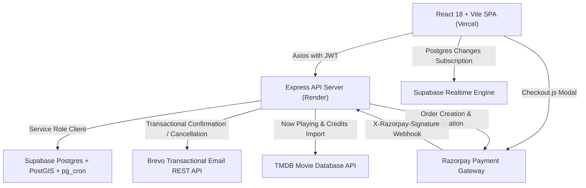
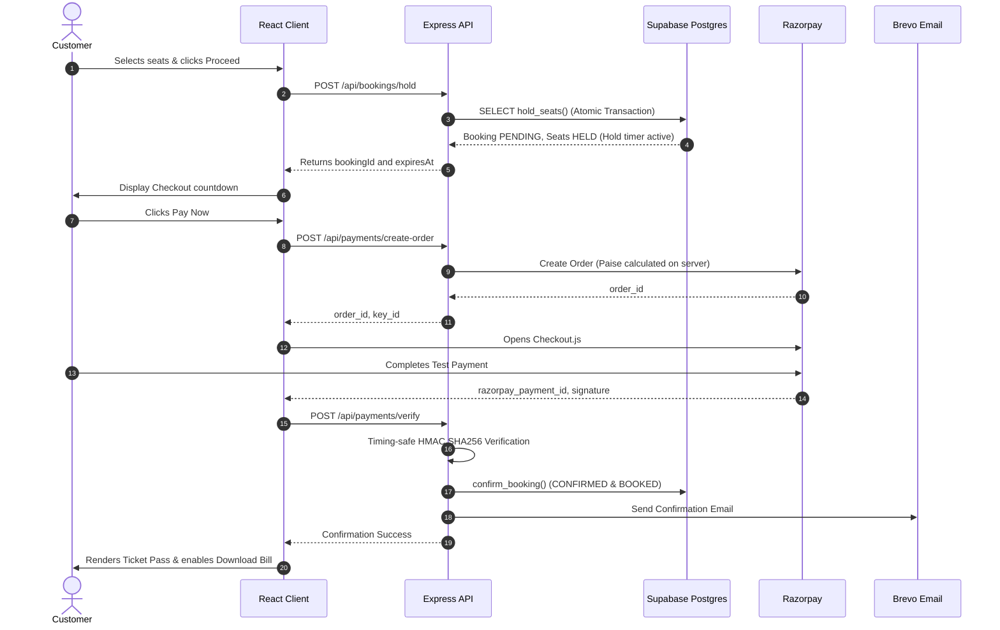

# System Architecture Overview

CineTicket is architected as a high-reliability, cloud-native full-stack application designed to handle high-concurrency ticket reservations, real-time seat locks, and transactional payment workflows.

## Seat Hold & Payment Flow

## Webhook Safety Net

If a customer closes their browser or encounters network disconnection immediately after authorization on Razorpay:
1. Razorpay dispatches `POST /api/payments/webhook` with signature `X-Razorpay-Signature`.
2. The server verifies HMAC SHA256 using `RAZORPAY_WEBHOOK_SECRET`.
3. Event idempotency is checked against `webhook_events`.
4. If not confirmed, `bookingService.processPaymentCapture` confirms the booking and dispatches the confirmation email.
5. Once confirmed, repeated webhook notifications or late verify calls execute idempotently without duplicating emails or records.
