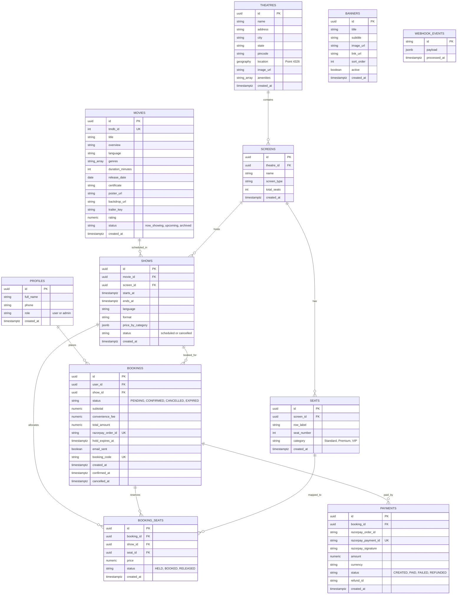

# Entity-Relationship Diagram

This document illustrates the database entities, attributes, and relationships across the CineTicket movie booking platform.

## Hard Double-Booking Guarantee

The critical guarantee against race conditions and concurrent bookings is enforced at the database level:

1. Partial unique index on `booking_seats (show_id, seat_id) WHERE status IN ('HELD', 'BOOKED')`.
2. Row-level transaction locks using `FOR SHARE` during `hold_seats`.
3. Screen showtime overlap exclusion constraint using `btree_gist` and `EXCLUDE USING gist (screen_id WITH =, tstzrange(starts_at, ends_at) WITH &&)`.
